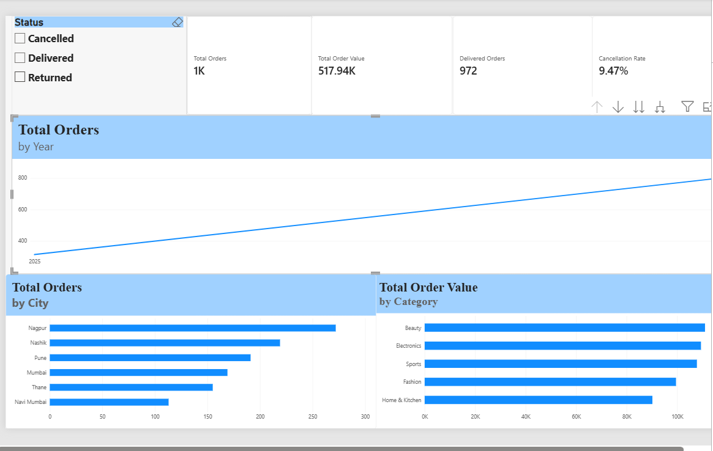
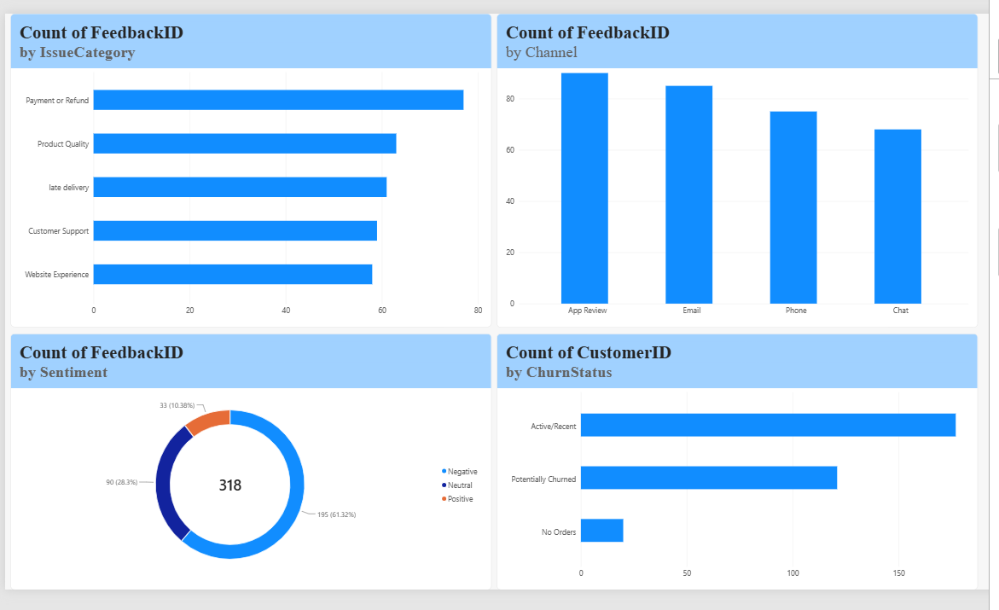

# AI-Powered Customer Support & Product Intelligence

## Project Overview
This project uses Excel, MySQL, and Power BI to analyze customer behaviour, order performance, and customer feedback. The goal is to identify potential customer churn risk, recurring complaints, and operational issues that could benefit from business intervention.

## Business Problem
Businesses need to understand why customers may stop purchasing, which complaints occur most frequently, and where cancellations and returns require attention. This project investigates these questions through structured data analysis and dashboard reporting.

## Objectives
- Analyze customer and order performance.
- Identify customers potentially at risk of churn.
- Understand common feedback categories and sentiment.
- Compare order cancellation patterns across cities and months.
- Translate findings into practical business recommendations.

## Tools and Techniques
- **Excel:** Data profiling, cleaning, PivotTables, customer-level analysis, and inactivity-based churn classification.
- **MySQL:** Filtering, aggregation, GROUP BY, joins, conditional logic, date functions, and subqueries.
- **Power BI:** KPI cards, line charts, bar charts, a donut chart, slicers, and a two-page interactive dashboard.

## Dataset
The project uses synthetic data with the following expected or observed records:
- 300 customers.
- 1,118 orders currently imported into MySQL.
- 318 feedback records.

The source workbook was expected to contain 1,119 orders. The difference between the expected and imported order counts remains unresolved.

## Key Findings
- 112 customers were classified as potentially churned using a 90-day order-inactivity rule.
- Payment or Refund was the most frequent feedback category, with 77 records.
- The imported order data contains 106 cancelled orders and 41 returned orders.
- Nagpur had the highest customer count, at 65.
- Navi Mumbai had an observed cancellation rate of 12.39%; city-label inconsistencies may affect this result.

## Recommendations
1. Investigate payment failures and refund delays.
2. Examine cancellation and return reasons by city and order status.
3. Test targeted re-engagement campaigns for potentially churned customers.
4. Standardize inconsistent city, feedback-category, and sentiment labels.
5. Monitor repeat purchases, cancellation rates, and customer feedback over time.

## Limitations
- The dataset is synthetic and does not represent a real company.
- Churn is a proxy based on order inactivity, not confirmed customer attrition.
- Feedback counts represent records, not necessarily unique customers.
- The order-count discrepancy and inconsistent text labels should be resolved before final reporting.
- The observed patterns are associations and do not establish causation.

## Deliverables
- Excel analysis workbook.
- SQL analysis queries.
- Power BI report with Business Overview and Customer Intelligence pages.
- Dashboard screenshots.

## Conclusion
This project demonstrates a practical business analytics workflow, from data preparation and SQL analysis to dashboard development and recommendations. It highlights how data can help prioritize customer experience and operational improvements.

## Project Status
The core analysis and dashboard have been created. Final data-quality reconciliation and portfolio packaging remain outstanding.

## Dashboard Preview

### Business Overview

### Customer Intelligence

